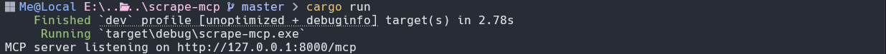

<h1 align="center">scrape-mcp</h1>

<p align="center">
  A small, fast <b>MCP server written in pure Rust</b> that gives your AI tools web search and page scraping.<br>
  <b>No API keys. No paid services. No headless browser.</b> Just <code>cargo run</code>.
</p>

---


## What it does

`scrape-mcp` is a [Model Context Protocol](https://modelcontextprotocol.io) server that runs on your own machine and exposes a single tool, **`web_extract`**. Any MCP-compatible client (LM Studio, Cursor, and others) can call it to:

- **Search the web** with Brave and get back clean, structured results: title, URL and snippet.
- **Scrape any page** and get back its title, main heading, paragraphs and links (resolved to absolute URLs).

It parses the HTML directly with the [`scraper`](https://crates.io/crates/scraper) crate, so the model receives structured data instead of a wall of text. That means less noise and fewer wasted tokens.

## Highlights

- **100% Rust.** Built on `tokio`, `axum`, `reqwest`, `scraper` and the official [`rmcp`](https://crates.io/crates/rmcp) SDK.
- **No API keys or accounts.** Search works by reading Brave's public results page.
- **Local-first.** Runs on `127.0.0.1`, and your queries never go through a third-party scraping service.
- **Streamable HTTP transport.** A real URL and port (`http://127.0.0.1:8000/mcp`), not stdio.
- **Structured output.** Search results come back as `{ title, url, snippet }`. Pages come back as `{ title, header, paragraphs, links }`.
- **Context-friendly.** Output is capped (200 paragraphs / links, 2,000 characters per item) and flagged with `truncated`.
- **Basic SSRF guard.** URLs pointing at `localhost` or private/link-local IP addresses are rejected by default.
- **Modular Rust 2024 code.** A library crate with small modules and no `mod.rs` files.

## Quick start

**Requirements:** Rust 1.88 or newer (`rustup update stable`). On Linux you also need `pkg-config` and `libssl-dev` (`sudo apt install pkg-config libssl-dev build-essential`).

```bash
git clone https://github.com/devilluminator/scrape-mcp.git
cd scrape-mcp
cargo run
```

```
MCP server listening on http://127.0.0.1:8000/mcp
```

Keep that terminal open while you use the server.

### Configuration

All settings are optional environment variables:

| Variable | Default | Description |
| --- | --- | --- |
| `MCP_BIND` | `127.0.0.1:8000` | Address and port to listen on |
| `MCP_MOUNT` | `/mcp` | URL path the MCP endpoint is mounted at |
| `MCP_ALLOW_PRIVATE` | `false` | Set to `1` or `true` to allow scraping `localhost` and private network addresses |

PowerShell:

```powershell
$env:MCP_BIND = "127.0.0.1:8080"; cargo run
```

Bash:

```bash
MCP_BIND=127.0.0.1:8080 cargo run
```

## Add it to your AI tool

Add the server to any MCP client that supports remote (Streamable HTTP) servers:

```json
{
  "mcpServers": {
    "scraper": {
      "url": "http://127.0.0.1:8000/mcp"
    }
  }
}
```

### LM Studio

1. Start the server with `cargo run`.
2. Open the **Program** tab, click **Install**, then **Edit mcp.json**. The file lives at `~/.lmstudio/mcp.json` (`%USERPROFILE%\.lmstudio\mcp.json` on Windows).
3. Add the `scraper` entry above to `mcpServers` and save. LM Studio reloads automatically.
4. Enable `web_extract` in the chat and use a model that supports tool calling.

### Other clients

- **Cursor** and other clients using the same `mcp.json` format take the snippet above as-is.
- If a client needs an explicit transport, add `"type": "http"` to the entry.
- If a client only supports stdio servers, bridge it with `npx mcp-remote http://127.0.0.1:8000/mcp`.

## The `web_extract` tool

| Parameter | Type | Description |
| --- | --- | --- |
| `search` | `bool` (default `false`) | `true` runs a Brave web search for `keyword`. `false` scrapes `url`. |
| `keyword` | `string` | Search query. Required when `search` is `true`. |
| `url` | `string` | Absolute `http(s)` URL. Required when `search` is `false`. |

### Example: search

```json
{ "search": true, "keyword": "rust async runtime" }
```

```json
{
  "source_url": "https://search.brave.com/search?q=rust+async+runtime&source=web",
  "title": "rust async runtime - Brave Search",
  "header": null,
  "results": [
    {
      "title": "Tokio - An asynchronous Rust runtime",
      "url": "https://tokio.rs/",
      "snippet": "Tokio is an event-driven, non-blocking I/O platform for writing asynchronous applications with Rust."
    }
  ],
  "paragraphs": [],
  "links": [],
  "truncated": false
}
```

### Example: scrape a page

```json
{ "search": false, "url": "https://example.com" }
```

```json
{
  "source_url": "https://example.com/",
  "title": "Example Domain",
  "header": "Example Domain",
  "paragraphs": ["This domain is for use in illustrative examples in documents."],
  "links": [{ "text": "More information...", "href": "https://www.iana.org/domains/example" }],
  "truncated": false
}
```

Errors are returned as `{ "error": "..." }` so the model can read them and react.

## Project layout

```
scrape-mcp/
├── Cargo.toml
├── examples/
│   └── dump.rs            # debug helper: saves and analyses the raw HTML
├── test-mcp.ps1           # PowerShell end-to-end test
└── src/
    ├── main.rs            # entry point
    ├── lib.rs             # module declarations
    ├── config.rs          # settings and output limits
    ├── error.rs           # typed errors
    ├── params.rs          # tool parameters (JSON schema)
    ├── page.rs            # output types
    ├── target.rs          # parameters to URL, host guard
    ├── fetch.rs           # HTTP request
    ├── extract.rs         # HTML to structured data
    ├── extract/
    │   ├── selectors.rs   # CSS selectors
    │   ├── text.rs        # text normalisation
    │   ├── links.rs       # link resolving and dedupe
    │   └── search.rs      # Brave result parsing
    ├── server.rs          # MCP server and the web_extract tool
    └── serve.rs           # axum router and Streamable HTTP
```

## Testing and debugging

```bash
cargo test                          # unit tests
cargo run --example dump -- Rust    # save + analyse the raw Brave HTML (writes debug.html)
```

## Limitations

- **Static HTML only.** There is no JavaScript rendering, so pages that build their content in the browser return little text.
- **Search depends on Brave's markup.** Results are parsed from the public results page. If Brave changes its HTML and `results` comes back empty, update the selectors in `src/extract/selectors.rs` (the `dump` example helps here).
- **Be considerate.** The scraper does not check `robots.txt` or rate-limit itself. Keep usage reasonable and respect the terms of the sites you scrape.
- **Keep it local.** The tool fetches whatever URL it is given. Don't expose the port to an untrusted network.

## License

MIT.
